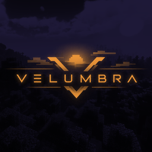

<p align="center">
  
</p>

<h1 align="center">Velumbra</h1>

<p align="center">A warm, cinematic shader pack for <a href="https://playhorizon.dev">Horizon</a>, the Minecraft client rewritten in Rust.</p>

Velumbra is written from scratch in WGSL for Horizon's native shader API (0.1). It aims for the soft, golden look
of classic Minecraft shader packs with publicly documented techniques, and keeps its cost measured: Medium is tuned
for 60 fps at 1080p on a laptop RTX 3050.

## Features

- **HDR post chain**: every stage stores light through one invertible curve, the post passes undo it and work in
  half floats, and one filmic curve maps the result at the end. Exposure adapts to caves and nights.
- **Sky**: analytic single scattering (Rayleigh and Mie phases, Kasten–Young air mass, ozone) with its own sun disc.
- **Night sky**: twinkling stars and a procedural Milky Way with dust lanes, turning with the sky; auroras on some
  nights and most nights in cold biomes.
- **Clouds**: ray-marched cumulus at half resolution with Wrenninge's multiple-scattering approximation, a cirrus
  layer above, blue-noise dithering and temporal accumulation.
- **Shadows**: percentage-closer soft shadows whose penumbra widens with the distance to the occluder, light tinted
  by stained glass, caustics under water.
- **Light shafts and mist**: volumetric sun rays through the shadow map, drifting mist in caves, the Nether and the
  End, all at half resolution and accumulated over frames.
- **Water**: waves, screen-space reflections falling back to the sky and clouds, optional mirror reflections,
  refraction, depth absorption and a sun glint.
- **Lighting**: warm sunlight, blue sky ambient, warm block light with a slight direction, translucent foliage, wet
  surfaces in rain, coloured lights from `[[lights]]` and dynamic lights.
- **Picture**: Jimenez's 13-tap bloom from HDR, temporal filtering with colour clipping, warm grade, vignette.

## Installation

1. Download `velumbra-<version>.hshader` from the releases, or build it (below).
2. Put it in Horizon's shader pack folder: `%APPDATA%\horizon\shaderpacks\` on Windows, or use the button that opens
   the pack folder in the game's shader pack screen.
3. Pick **Velumbra** in the shader pack list.

The pack replaces vanilla's clouds, sun and stars; the moon stays.

## Quality presets

| | Low | Medium | High | Ultra |
|---|---|---|---|---|
| Cloud steps (light steps) | 8 (2) | 14 (3) | 22 (4) | 32 (6) |
| Light shaft steps | 6 | 10 | 16 | 24 |
| Mist steps | 3 | 4 | 6 | 8 |
| Shadow blocker search / filter taps | 0 / 4 (plain PCF) | 5 / 8 | 8 / 12 | 12 / 16 |
| Water screen-space reflection steps | sky only | 14 | 22 | 32 |
| Aurora layers | 6 | 10 | 14 | 20 |
| Milky Way | simplified | dust lanes | dust lanes | dust lanes |
| Caustics | off | on | on | on |

The shadow map's resolution and distance are separate options (1536 and 128 blocks by default).

## Estimated cost

Estimates at 1080p on a laptop RTX 3050, in milliseconds, for an open landscape at noon with water in view. They
come from the work each pass does, not from a measurement: F3's GPU timers in the game show the real numbers
per pass, and the next release will replace this table with them.

| Pass | Resolution | Low | Medium | High | Ultra |
|---|---|---|---|---|---|
| Shadow map (Horizon, 1536) | 1536² | 0.6 | 0.6 | 0.6 | 0.6 |
| Sky | sky pixels | 0.15 | 0.25 | 0.35 | 0.5 |
| Terrain and water | full | 0.4 | 0.8 | 1.2 | 1.7 |
| Clouds, light shafts, mist | half | 0.7 | 1.2 | 2.1 | 3.3 |
| Volumetrics history | half | 0.03 | 0.03 | 0.03 | 0.03 |
| Fog and volumetrics | full | 0.3 | 0.3 | 0.3 | 0.3 |
| Bloom | quarter | 0.2 | 0.2 | 0.2 | 0.2 |
| Temporal filter | full | 0.2 | 0.2 | 0.2 | 0.2 |
| Tone map and grade | full | 0.1 | 0.1 | 0.1 | 0.1 |
| **Total over vanilla** | | **~2.7** | **~3.7** | **~5.1** | **~6.9** |

Early-outs keep the worst cases down: cloud marching stops at terrain, under thick cloud and outside the cloud
slab; light shafts stop underground; shadow filtering stops when the blocker search finds nothing. Mirror
reflections render the world a second time and can double the terrain cost, so they are off by default.

## Settings

The options screen opens on the preset and exposure, with pages for Lighting (shadows, light shafts, mist, fog), Sky
(clouds, night sky, auroras, wind), Water (waves, mirror reflections) and Picture (bloom, saturation, warmth,
vignette, temporal filter).

## Connected glass

A shader pack cannot do it: the material stage sees one point of one face, not the neighbouring blocks. Horizon
reads OptiFine and Continuity connected-texture resource packs (`optifine/ctm/**/*.properties`, every method), so a
CTM resource pack for glass and stained glass gives seamless glass alongside Velumbra.

## Building

```powershell
./build.ps1        # Windows PowerShell
```

```bash
./build.sh         # Linux, macOS, Git Bash
```

Both check the pack with `tools/check.py` and write `dist/velumbra-<version>.hshader`. The check composes every
stage the way Horizon does, with Horizon's own prelude (`tools/prelude/`, extracted from `horizon-shader-api`),
validates it with [naga](https://github.com/gfx-rs/wgpu/tree/trunk/naga) (`cargo install naga-cli`), translates it
to SPIR-V, Metal and HLSL with the options at their defaults, minimums and maximums, and enforces the manifest's
rules (bindings, names, overrides, post targets, pages, texture reads). Pass `-SkipValidation` or
`--skip-validation` to package without it.

`python tools/preview.py` renders the sky, night sky, clouds, water and tone curve into `preview/` with a NumPy port
of the shaders. `python tools/blue_noise.py` regenerates the blue-noise texture.

## Layout

```
src/horizon-shaders.toml     manifest: stages, passes, materials, options, pages
src/common.wgsl              shared: HDR encoding, exposure, atmosphere, noise, clouds, waves
src/sky.wgsl                 sky, sun, stars, Milky Way, auroras
src/terrain/                 material (lighting), shadows (PCSS, caustics), water (SSR), vertex (wind)
src/weather.wgsl             rain and snow
src/post/volume.wgsl         clouds, light shafts and mist at half resolution, temporally blended
src/post/composite.wgsl      fog and the volumetrics brought up to full resolution
src/post/bloom_*.wgsl        bloom
src/post/temporal.wgsl       temporal filter
src/post/final.wgsl          tone map and grade
src/textures/blue_noise.png  4-channel blue noise
tools/                       check, prelude, previews, blue-noise generator
```

## Limits

- Horizon draws shader API 0.2 packs (linear-light frame, `[tonemap]`) only with `HORIZON_HDR_FRAME=float` set,
  so Velumbra stays on 0.1. The world's frame is 8-bit there, which caps stored highlights at about 6 times white
  before the post chain takes over in half floats.
- Entities, block entities, particles and the hand are drawn by Horizon with vanilla's lighting: API 0.1 has no
  stage for them.
- The sky stage gets no pixel position, so the auroras use per-ray hash noise rather than blue noise; the
  temporal filter smooths it.

## License

[MIT](LICENSE). The logo is part of the project and shares its license. `tools/prelude/` is extracted from Horizon's
`horizon-shader-api` (MIT).
